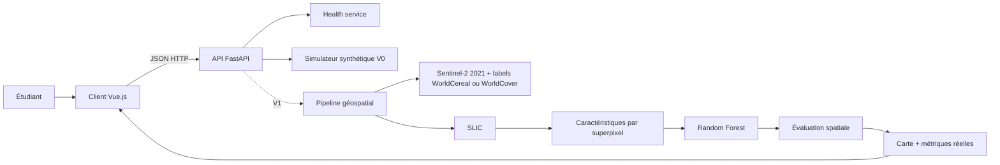

# Architecture

## 1. Vue d’ensemble



## 2. Composants

### Client Vue.js + Vite

- présente le tableau de bord et les paramètres de démonstration ;
- appelle uniquement l’API, sans recalculer les scores ;
- affiche carte, classe, matrice de confusion, métriques et état de simulation ;
- garde l’URL de l’API configurable via variable Vite.

### API FastAPI

- définit les schémas d’entrée/sortie Pydantic ;
- expose l’état de service, le profil de démonstration et le lancement de simulation ;
- valide les bornes des paramètres et retourne les erreurs HTTP adaptées ;
- fournit la documentation OpenAPI via `/docs` et `/openapi.json` ;
- limite CORS au client local en développement.

### Simulateur V0

- génère un résultat stable à partir d’une matrice de confusion illustrative fixée dans le code ;
- calcule les métriques depuis la matrice plutôt que de stocker des scores incohérents ;
- produit une grille cartographique synthétique et des importances fictives ;
- marque chaque réponse avec `is_simulation: true` et `data_source: synthetic_demo`.

### Pipeline géospatial V1 (future)

1. Chargement de l’emprise cadrée `data/aoi/mbanza_ngungu_10km.geojson` autour de Mbanza‑Ngungu, Kongo Central (AEZ 4010), puis inventaire des images Sentinel‑2 L2A 2021 et des pixels WorldCereal disponibles.
2. Alignement sur une grille commune et application du masque nuages/ombres.
3. Composition représentative et segmentation SLIC de référence.
4. Statistiques par superpixel/date, indices et résumés temporels.
5. Association des labels proxy WorldCereal (cultures temporaires / hors cultures temporaires ; éventuellement maïs / non-maïs dans le masque agricole pour la saison principale) ; repli WorldCover (cultivé / autre couverture) ; contrôle confiance/pureté et exclusion du NoData.
6. Partition spatiale, entraînement RF et réglage sur validation.
7. Évaluation finale et export carte/table/modèle.

## 3. Contrat de données attendu pour V1

### Raster

Chaque date doit exposer des bandes et métadonnées traçables. Bandes visées : B2, B3, B4, B8, B11, B12. Les grilles doivent partager projection, emprise, dimensions, transformée et résolution après harmonisation. Les pixels invalides ont un masque explicite.

### Labels

Pour le pilote, l’AEZ officielle WorldCereal 4010 contient le carré de cadrage et définit un calendrier `tc-maize-main` (DOY 43–214). Vérifier d’abord les pixels de classification et de confiance du produit annuel `temporarycrops`, puis ceux du produit saisonnier `maize`. En repli, ESA WorldCover 2021 à 10 m : classe 40 « cropland » regroupée en `cultivé`, autres classes valides regroupées en `autre couverture`. Dans tous les cas, ce sont des labels cartographiques indirects, pas des relevés par parcelle ; les scores mesurent l’accord avec le produit de référence. Pour une vérité terrain indépendante, obtenir des points/polygones locaux avec nomenclature, date, licence et identifiant spatial.

Le code de groupe (bloc spatial, ou parcelle si un inventaire local est obtenu) sert à la séparation indépendante des ensembles.

### Table de caractéristiques

Une ligne par superpixel ; colonnes stables pour l’identifiant, la classe/pureté, le groupe spatial, les dates et variables spectraux/temporelles. Le dictionnaire de colonnes accompagne la table.

## 4. Organisation du dépôt

```text
.
├── README.md
├── doc/
│   ├── README.md
│   ├── SPECIFICATION.md
│   ├── ARCHITECTURE.md
│   ├── BACKLOG.md
│   ├── API.md
│   ├── TESTS_SIMULATION.md
│   └── RUNBOOK.md
├── backend/
│   ├── requirements.txt
│   ├── app/
│   │   ├── main.py
│   │   ├── schemas.py
│   │   ├── metrics.py
│   │   ├── simulator.py
│   │   └── pipeline/
│   │       ├── segmentation.py
│   │       ├── features.py
│   │       ├── labels.py
│   │       ├── spatial_split.py
│   │       └── classifier.py
│   ├── requirements-pipeline.txt
│   ├── examples/
│   │   ├── simulation_result_demo.json
│   │   └── pipeline_config_template.json
│   └── tests/
│       ├── test_api.py
│       └── test_pipeline_primitives.py
├── frontend/
│   ├── package.json
│   ├── index.html
│   └── src/
└── data/                 # à créer pour V1, non versionner les gros rasters
```

## 5. Décisions d’architecture

| Décision | Choix V0/V1 | Raison |
|---|---|---|
| Interface | Vue.js 3 avec Vite | Client web léger pour visualiser la démonstration et les cartes. |
| Backend | FastAPI + modèles Pydantic | API Python adaptée au futur traitement scientifique et au contrat JSON. |
| Exécution de la démo | Synchrone | Calcul instantané et déterministe ; pas de file de tâches nécessaire. |
| Calcul géospatial V1 | Module séparé du routeur API | Permet de tester le pipeline indépendamment de l’interface. |
| Taille du démonstrateur | Traitement local synchrone | Suffisant pour présenter le TP ; pas de worker, compte utilisateur ou hébergement à construire. |
| Stockage V0 | Aucun stockage persistant | Le résultat est une démo reproductible. |
| Stockage V1 | Fichiers rasters/tables versionnés par run | Les images et artefacts sont volumineux et doivent rester traçables. |
| Zone pilote | Carré d’environ 10 × 10 km autour de Mbanza‑Ngungu, Kongo Central ; AEZ 4010 | Polygone de cadrage conservé en GeoJSON ; l’AEZ et la saison sont identifiées, les pixels locaux restent à contrôler. |
| Labels V1 | ESA WorldCereal 2021, annuel et saison maïs à contrôler ; WorldCover en repli | Cartes à 10 m avec confiance pour WorldCereal ; présenter les scores comme accord cartographique. |
| Évaluation | Groupes par parcelle/bloc | Réduit la fuite liée aux superpixels spatiaux voisins. |

## 6. Dépendances logicielles prévues

Backend : Python, FastAPI, Uvicorn, Pydantic ; V1 ajoutera selon les données Rasterio, NumPy, pandas/GeoPandas, scikit-image et scikit-learn.  
Frontend : Node.js, Vue.js 3, Vite.  
Les versions exactes seront verrouillées au démarrage et consignées ; les exigences Node seront vérifiées avec la version courante de Vite.

Le schéma de réponse FastAPI contrôle les dimensions de la matrice, les identifiants de classe, les comptes et les scores. `backend/app/pipeline/` contient les primitives array-based de calcul scientifique ; ces modules ne sont pas importés par la démo et restent séparés de la simulation. Le modèle de configuration de `backend/examples/pipeline_config_template.json` est documentaire à ce stade ; il ne déclenche pas de calcul. Les dépendances scientifiques optionnelles restent séparées des dépendances légères nécessaires au client de démonstration et s’installent avec `requirements-pipeline.txt`.

## 7. Sources techniques

- [Vue — démarrage et outil officiel create-vue/Vite](https://vuejs.org/guide/quick-start.html)
- [Vite — guide et compatibilité Node.js](https://vite.dev/guide/)
- [FastAPI — premières routes et documentation OpenAPI](https://fastapi.tiangolo.com/tutorial/first-steps/)
- [FastAPI — tests avec TestClient](https://fastapi.tiangolo.com/tutorial/testing/)
- [scikit-image — SLIC multicanal et masques](https://scikit-image.org/docs/stable/api/skimage.segmentation.html)
- [Rasterio — rééchantillonnage](https://rasterio.readthedocs.io/en/stable/topics/resampling.html)
- [scikit-learn — séparation par groupes](https://scikit-learn.org/stable/modules/cross_validation.html#cross-validation-iterators-for-grouped-data)
